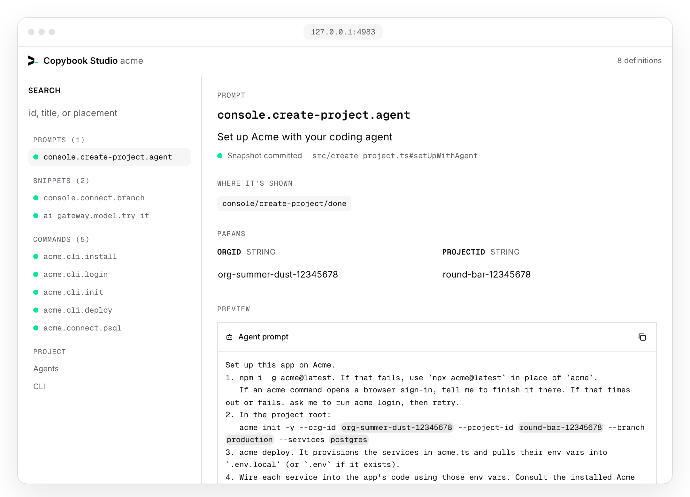

<div align="center">

<picture><source media="(prefers-color-scheme: dark)" srcset="https://shieldcn.dev/header/glow.svg?title=Copybook&amp;subtitle=Typed%2C%20tested%20snippets%2C%20commands%2C%20and%20agent%20prompts%20for%20your%20product&amp;theme=emerald&amp;mode=dark&amp;logo=data%3Aimage%2Fsvg%2Bxml%3Bbase64%2CPHN2ZyB4bWxucz0iaHR0cDovL3d3dy53My5vcmcvMjAwMC9zdmciIHZpZXdCb3g9IjAgMCAyNCAyNCI%2BPHBhdGggZD0iTTAgMCAxNC41IDYuNVYxNy41TDAgMjRWMTdMMTMgMTIgMCA3WiIgZmlsbD0iI2ZmZiIvPjxyZWN0IHg9IjE3IiB5PSIxNSIgd2lkdGg9IjciIGhlaWdodD0iMi41IiBmaWxsPSIjMDBlNTk5Ii8%2BPC9zdmc%2B" /></picture>

<a href="https://www.npmjs.com/package/@copybook/core"><picture><source media="(prefers-color-scheme: dark)" srcset="https://shieldcn.dev/npm/@copybook/core.svg?label=core&amp;variant=outline&amp;theme=emerald&amp;mode=dark" /></picture></a> <a href="https://www.npmjs.com/package/@copybook/cli"><picture><source media="(prefers-color-scheme: dark)" srcset="https://shieldcn.dev/npm/@copybook/cli.svg?label=cli&amp;variant=outline&amp;theme=emerald&amp;mode=dark" /></picture></a> <a href="https://www.npmjs.com/package/@copybook/core"><picture><source media="(prefers-color-scheme: dark)" srcset="https://shieldcn.dev/npm/dm/@copybook/core.svg?variant=outline&amp;theme=emerald&amp;mode=dark" /></picture></a> <a href="https://github.com/neon-solutions/copybook/actions"><picture><source media="(prefers-color-scheme: dark)" srcset="https://shieldcn.dev/github/ci/neon-solutions/copybook.svg?variant=outline&amp;theme=emerald&amp;mode=dark" /></picture></a> <a href="LICENSE.md"><picture><source media="(prefers-color-scheme: dark)" srcset="https://shieldcn.dev/github/license/neon-solutions/copybook.svg?variant=outline&amp;theme=emerald&amp;mode=dark" /></picture></a> <a href="https://github.com/neon-solutions/copybook/stargazers"><picture><source media="(prefers-color-scheme: dark)" srcset="https://shieldcn.dev/github/stars/neon-solutions/copybook.svg?variant=outline&amp;theme=emerald&amp;mode=dark" /></picture></a> <a href="https://copybook.dev/docs/components"><picture><source media="(prefers-color-scheme: dark)" srcset="https://shieldcn.dev/badge/shadcn-%40copybook-10b981.svg?logo=shadcnui&amp;variant=outline&amp;theme=emerald&amp;mode=dark" /></picture></a> <a href="https://copybook.dev/docs"><picture><source media="(prefers-color-scheme: dark)" srcset="https://shieldcn.dev/badge/docs-copybook.dev-10b981.svg?logo=lu:BookOpen&amp;variant=outline&amp;theme=emerald&amp;mode=dark" /></picture></a>

</div>

> Copybook is at 0.x, so minor releases can include breaking changes. The [changelog](content/docs/changelog.mdx) lists them.

Define, test, and track the code snippets and agent prompts your users copy. Docs and examples are at [copybook.dev](https://copybook.dev).

<picture>
  <source media="(prefers-color-scheme: dark)" srcset="https://raw.githubusercontent.com/neon-solutions/copybook/main/.github/assets/studio-dark.png" />
  
</picture>

<sub>Copybook Studio (<code>npx copybook studio</code>) lists every definition, where it is shown, its params, and what users copy.</sub>

Developer tools now ship a lot of copy-paste content: "Connect" dialogs with snippets in five languages, model pages with per-framework examples, and "paste this into your coding agent" prompts. That content usually lives as strings scattered across components, so nobody can easily answer:

- **What** snippets and prompts do we show, and **where**?
- **Do** all the code examples still **work**?
- Do the prompts still **perform well** with today's agents?
- **When** did each one last change?

Copybook answers these by making every snippet, command, and prompt a typed, versioned definition:

```ts
import { defineCommand, definePrompt, p } from "@copybook/core";

export const init = defineCommand({
  id: "acme.init",
  params: { projectId: p.string().example("proj-example") },
  template: (t, { projectId }) => t`acme init --project-id ${projectId}`,
});

export const getStarted = definePrompt({
  id: "console.create-project.agent",
  placements: ["console/create-project"],
  params: { projectId: p.string().example("proj-example") },
  template: (t, params) => t`
    Set up this app on Acme.
    1. Install the CLI: ${t.cmd("npm i -g acme@latest")}
    2. In the project root: ${t.cmd(init, params)}
  `,
});
```

## Packages

| Package | Description |
| --- | --- |
| `@copybook/core` | Isomorphic, zero-dependency definitions and rendering. This is what your product imports. |
| `@copybook/cli` | `list`, `snapshot`, `check`, `test`, `eval`, `usages`, `report`, and `studio`. |
| Registry components | shadcn components for agent prompts, code variants, and command tabs. |

```bash
npx @copybook/cli init   # writes copybook.config.ts and installs both packages
```

Then, from your project:

```bash
npx copybook snapshot   # rendered snapshots; commit them
npx copybook check      # CI: fail when a snapshot is stale
npx copybook test       # parse, typecheck, and run snippets
npx copybook eval       # give prompts to coding agents (CI only)
npx copybook studio     # browse everything locally
```

The [docs](https://copybook.dev/docs) cover the [quick start](https://copybook.dev/docs/quick-start), each concept, and the registry components.

`examples/acme` models Neon's onboarding screens for a fictional "Acme DB", and every command above runs against it without an account.

## Used by

[Neon](https://neon.com) tracks the agent prompts on its docs with Copybook. Every pull request that changes one gets a report with the rendered before and after and the pages that use it, like [this one](https://github.com/neondatabase/website/pull/6926#issuecomment-7052237787).

## Development

This repository is a pnpm workspace. The Next.js site (landing page, docs, and shadcn registry) lives at the root, and the publishable packages live in `packages/*`.

```bash
pnpm install
pnpm dev         # site
pnpm check       # lint + format check (Ultracite)
pnpm typecheck
pnpm test
pnpm check:content   # snapshots of the site and Acme
pnpm test:content    # tests for the site and Acme
pnpm dev:studio      # Studio UI against examples/acme
```

See [CONTRIBUTING.md](CONTRIBUTING.md) for details.

## License

[MIT](LICENSE.md)
